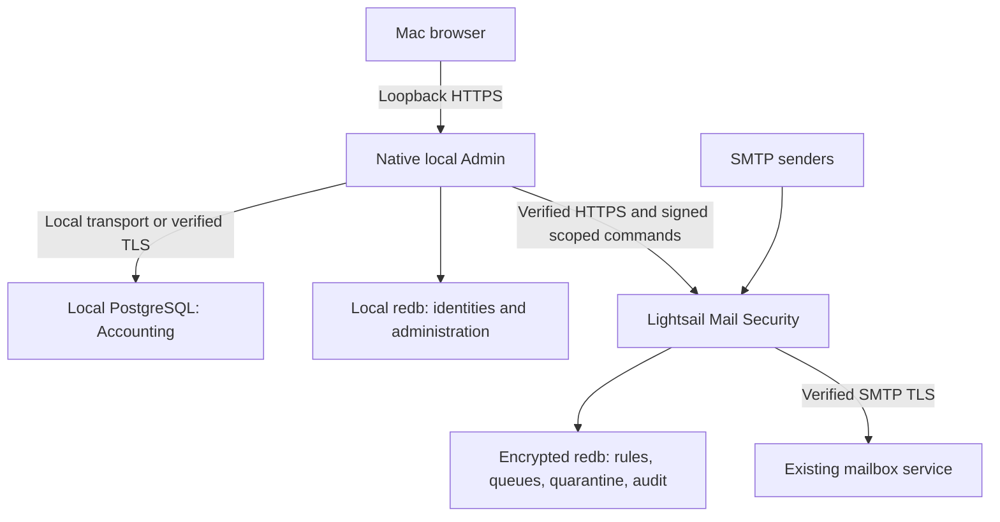

# Current Workglen architecture

Updated 2026-10-24. This describes implemented structure; [MODULES.md](MODULES.md), [SCALING.md](SCALING.md) and the historical remote-module design also contain future targets. Code and [VALIDATION.md](VALIDATION.md) define the tested behavior.

## Process and storage boundaries

- **Local Admin:** the `admin_only=true` profile in the existing Rust executable serves loopback HTTPS and the loopback authenticated CLI. It starts no Mail/SMTP/IMAP/Webmail/relay/replication/witness listeners or workers. Accounting may run in the same process with a separately configured database. No Electron, Node or Python runtime is required.
- **Accounting:** PostgreSQL is authoritative for journals, accounts, invoices/bills, statements, reconciliation and correction/audit history. The Mac deployment uses an existing local server. `transport="local"` is an explicit exception for literal loopback TCP or absolute Unix sockets only; no DNS endpoint, hostaddr override, remote address or multi-host fallback is accepted. Remote databases default to verified TLS. PostgreSQL disk encryption and backups are independent of gateway redb encryption.
- **Mail Security:** a separate `security-serve` process owns its encrypted redb database and SMTP/HTTPS interfaces. Native scanning, spam heuristics, rule lifecycle, quarantine, queues, digests and optional mailbox connectors continue independently of Admin availability. The gateway neither stores Accounting data nor connects to the Mac's PostgreSQL.
- **Mail/Core:** the ordinary Mail profile remains available for mailbox hosting, direct delivery/DKIM, Webmail and cluster replication. The split installer intentionally targets local Admin plus standalone Mail Security. Use the existing Mail configuration/deployment guides for mailbox hosting or dual-node setups.

The local Admin redb is not encrypted by the Mail Security encrypted backend. It contains administration/RBAC state and audit metadata; protect the Mac user account and filesystem. Gateway whole-database encryption, BYOK/generated keys, crash recovery and key-loss behavior are specified in [security/ENCRYPTED-STORAGE.md](security/ENCRYPTED-STORAGE.md). Quarantine originals remain in the gateway store unless an authorized inspection/response explicitly retrieves them.

## Remote trust, roles and audit

The local Admin has an installation-owned registry of gateway origins, instance IDs and management-key paths. Browser requests cannot supply arbitrary target URLs. Commands carry a workspace binding, target audience, timestamp, nonce, originating actor, permissions, scopes and request ID, signed with the management key. The gateway verifies signature, replay/time bounds and independent authorization ceilings. A matching key alone does not bypass command-specific RBAC or mandatory quarantine guards.

The installer creates a workspace owner console and a separate gateway recovery login. The initial trusted central ceiling permits workspace-wide administration of that paired instance; delegate narrower domain/mailbox/instance roles through Access. Accounting roles, including external accountant/contractor access, remain separate from Security roles. Key provisioning and gateway registration are installation operations. Online management-key rotation is not claimed by this installer.

Gateway rule/identity/configuration and content actions retain native append-only audit evidence. Accounting journals and corrections retain their own PostgreSQL audit, source constraints and period locks. Authentication, encrypted data and audit histories are not copied into one central database. A disconnected Mac cannot report fresh gateway status; it does not suspend established protection.

## TLS and delivery lifecycle

The gateway uses native ACME HTTP-01 with Let's Encrypt, ARI renewal scheduling and live certificate replacement. Manual/private-CA certificates remain an option. Certificate state and keys stay private on their host. The Mac's private localhost endpoint uses a separately generated certificate that the operator explicitly trusts locally; it is not enrolled in public ACME. All remote management keeps hostname verification enabled.

The gateway is initially paused. Operators provision domains/recipients and verified SMTP next hops, test Development/Test rules without effects, then activate a tested version and enable prospective enforcement. Retrospective mailbox remediation requires its own preview/confirmation and a supported connector. Queue delivery and uncertainty handling preserve evidence; SMTP is not described as exactly-once delivery.

## Cryptography ownership

Pratique provides all TLS (including PostgreSQL through a first-party adapter), AES-256-GCM, HMAC-SHA256, DKIM RSA signing/key generation and local certificate provisioning. The installer invokes native `setup-*` commands. OpenSSL is not required to build, install or run Workglen; independent test peers may use it during development. See [PRATIQUE-INTEGRATION.md](PRATIQUE-INTEGRATION.md) for implementation and validation boundaries.

## Implementation boundaries

Independent remote Mail Security management is implemented. Arbitrary remote hosting/administration of every module, a signed macOS application bundle, hosted central control, management-key rotation, a universal cross-OS binary, RAR/7z decoding, full antivirus/signature coverage and live Microsoft-provider certification are not claimed. See the indexed backlog, design targets and validation record for specifics.

The source ZIP intentionally retains historical implementation/review notes with their version labels. Those are context and evidence, not upgrade/import code. Current initialization targets fresh installs and reopening the current schema; external accounting interchange remains supported separately.
